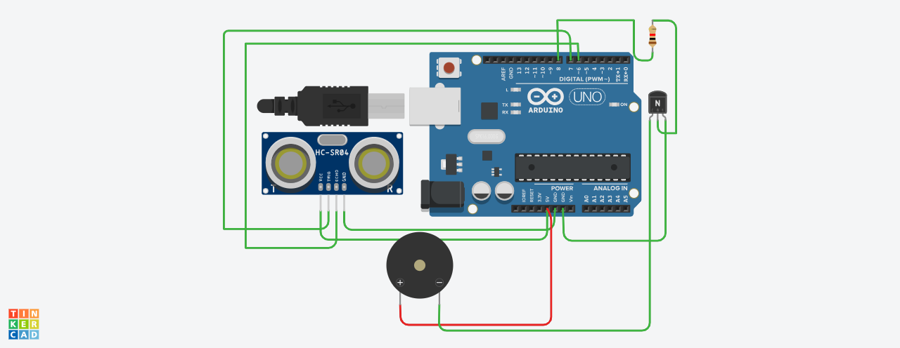

# 🦯 Blindstick – Smart Obstacle Detection Cane

An Arduino-based electronic walking aid that helps visually impaired people detect obstacles ahead. An ultrasonic sensor continuously measures the distance to objects, and a buzzer gives audio feedback — the closer the obstacle, the faster the beeping.


-blue)


---

## 📑 Table of Contents

- [Overview](#-overview)
- [Features](#-features)
- [Components Required](#-components-required)
- [Circuit Diagram](#-circuit-diagram)
- [Pin Connections](#-pin-connections)
- [How It Works](#-how-it-works)
- [Installation & Setup](#-installation--setup)
- [Serial Monitor Output](#-serial-monitor-output)
- [Project Structure](#-project-structure)
- [Future Improvements](#-future-improvements)
- [Contributing](#-contributing)
- [License](#-license)

---

## 📖 Overview

Traditional white canes cannot detect obstacles above ground level or beyond their physical reach. **Blindstick** extends the cane's awareness using an HC-SR04 ultrasonic distance sensor and an audible alert system. The device is low-cost, easy to build, and runs on a standard Arduino UNO.

## ✨ Features

- 📏 Real-time obstacle detection up to **100 cm**
- 🔊 Three-level audio feedback based on distance
- 💰 Low-cost and built from easily available components
- 🖥️ Serial monitor output for debugging and calibration
- 🔧 Simple, readable code that is easy to modify

## 🧰 Components Required

| Component | Quantity |
|---|---|
| Arduino UNO | 1 |
| HC-SR04 Ultrasonic Sensor | 1 |
| Piezo Buzzer (active) | 1 |
| NPN Transistor (e.g., BC547 / 2N2222) | 1 |
| Resistor (~1 kΩ) | 1 |
| Jumper Wires | As needed |
| Breadboard | 1 |
| 9V Battery / Power Bank (for portable use) | 1 |

## 🔌 Circuit Diagram



*Circuit designed and simulated in [Tinkercad Circuits](https://www.tinkercad.com/circuits).*

## 📍 Pin Connections

### HC-SR04 Ultrasonic Sensor

| HC-SR04 Pin | Arduino Pin |
|---|---|
| VCC | 5V |
| TRIG | D7 |
| ECHO | D6 |
| GND | GND |

### Buzzer (driven through NPN transistor)

| Connection | Goes To |
|---|---|
| Buzzer (+) | 5V |
| Buzzer (−) | Transistor Collector |
| Transistor Base | Arduino D8 (through resistor) |
| Transistor Emitter | GND |

> 💡 The transistor acts as a switch so the buzzer is not powered directly from the Arduino's I/O pin, protecting the board and allowing a louder output.

## ⚙️ How It Works

1. The Arduino sends a 10 µs pulse to the **TRIG** pin of the HC-SR04.
2. The sensor emits an ultrasonic burst and the **ECHO** pin stays HIGH until the reflection returns.
3. The Arduino measures this pulse width using `pulseIn()` (with a 30 ms timeout).
4. Distance is calculated as:

   ```
   distance (cm) = duration (µs) / 58
   ```

5. The buzzer pattern is chosen based on distance:

| Distance | Buzzer Behaviour | Meaning |
|---|---|---|
| 0 – 20 cm | Continuous tone | 🔴 Obstacle very close |
| 20 – 50 cm | Fast beeping (150 ms on / 150 ms off) | 🟠 Obstacle nearby |
| 50 – 100 cm | Slow beeping (300 ms on / 500 ms off) | 🟡 Obstacle ahead |
| > 100 cm / no echo | Silent | 🟢 Path clear |

## 🚀 Installation & Setup

1. **Clone the repository**
   ```bash
   git clone https://github.com/<your-username>/Blindstick.git
   cd Blindstick
   ```
2. **Assemble the circuit** as shown in the [circuit diagram](#-circuit-diagram).
3. **Open** `Blindstick.ino` in the [Arduino IDE](https://www.arduino.cc/en/software).
4. Select **Tools → Board → Arduino UNO** and choose the correct **Port**.
5. Click **Upload**.
6. Open the **Serial Monitor** at **9600 baud** to view live distance readings.

### Configuration

Pin assignments and thresholds can be changed at the top of `Blindstick.ino`:

```cpp
const int trigPin = 7;
const int echoPin = 6;
const int buzzerPin = 8;
```

## 🖥️ Serial Monitor Output

```
Distance: 85.43 cm
Distance: 47.12 cm
Distance: 18.90 cm
Distance: 0.00 cm      <-- no echo received (nothing in range)
```

## 📂 Project Structure

```
Blindstick/
├── Blindstick.ino          # Arduino source code
├── LICENSE
├── images/
│   └── circuit-diagram.png # Circuit diagram (Tinkercad)
└── README.md
```

## 🔮 Future Improvements

- Add a vibration motor for deaf-blind users
- Add multiple sensors for left/right/front detection
- Replace the buzzer with voice alerts (DFPlayer Mini)
- Add a rechargeable battery with charging module (TP4056)
- Miniaturise using Arduino Nano / ATtiny and a custom PCB
- Add GPS / GSM module for emergency location sharing

## 🤝 Contributing

Contributions are welcome!

1. Fork the repository
2. Create a feature branch (`git checkout -b feature/new-feature`)
3. Commit your changes (`git commit -m "Add new feature"`)
4. Push to the branch (`git push origin feature/new-feature`)
5. Open a Pull Request

## 📜 License

This project is licensed under the **MIT License** — feel free to use, modify, and distribute it.

---

⭐ If you found this project useful, consider giving it a star!
